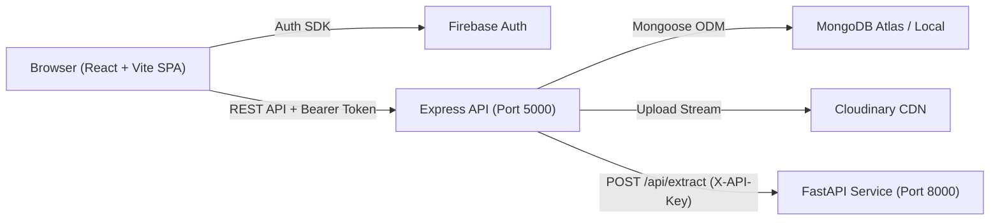

# BrandLens AI

> **Intelligent brand governance, before you publish.**

BrandLens AI is a multi-tenant, explainable pre-publication content review and approval platform. It checks marketing drafts, documents, and visual assets against an organisation's approved brand guidelines, terminology rules, verified facts, and accessibility standards—providing source-cited findings, immutable version history, separation-of-duties approval gates, and exportable compliance certificates while keeping authorised humans in control.

---

## Table of Contents

1. [Project Overview & Objectives](#1-project-overview--objectives)
2. [Problem Statement & Proposed Solution](#2-problem-statement--proposed-solution)
3. [Complete Feature List](#3-complete-feature-list)
4. [Technology Stack](#4-technology-stack)
5. [System Architecture](#5-system-architecture)
6. [Repository & Service Structure](#6-repository--service-structure)
7. [Prerequisites & Installation](#7-prerequisites--installation)
8. [Environment Variable Configuration](#8-environment-variable-configuration)
9. [MongoDB Setup](#9-mongodb-setup)
10. [Cloudinary Configuration](#10-cloudinary-configuration)
11. [Gemini API Configuration](#11-gemini-api-configuration)
12. [Running All Services Locally](#12-running-all-services-locally)
13. [API Endpoints Documentation](#13-api-endpoints-documentation)
14. [Authentication & Authorization](#14-authentication--authorization)
15. [Testing Instructions](#15-testing-instructions)
16. [Deployment Instructions](#16-deployment-instructions)
17. [Troubleshooting Guide](#17-troubleshooting-guide)
18. [Future Development Roadmap](#18-future-development-roadmap)
19. [Team ALGO_X](#19-team-algo_x)

---

## 1. Project Overview & Objectives

BrandLens AI is designed for marketing, communications, legal, and brand governance teams who need an auditable pre-publication control gate before copy or visual assets go live.

**Core Objectives:**
- **Eliminate brand drift and unapproved claims** by validating copy against versioned organisation-scoped rules and approved facts.
- **Prevent fabricated citations** by distinguishing 100% deterministic checks (terminology, WCAG contrast, alt-text) from grounded semantic checks against approved brand facts.
- **Keep humans accountable** through per-finding Accept / Edit / Reject / Override decisions (with mandatory reasons), independent manager sign-off (Separation of Duties), version locking, and an append-only audit ledger.
- **Provide tamper-evident proof of compliance** via downloadable Pre-Publication Compliance Certificates (PDF, Markdown, JSON).

---

## 2. Problem Statement & Proposed Solution

### Problem Statement
Modern teams publish rapidly across blogs, social media, emails, and press releases. Manual brand reviews suffer from:
- Outdated PDF style guides that writers rarely cross-check.
- Inconsistent terminology, unverified superlative claims ("100% risk-free"), and inaccessible visuals failing WCAG 2.1 contrast or missing alt text.
- Black-box AI tools that rewrite copy aggressively, hallucinate citations, or lack formal audit trails.
- Lack of separation of duties—allowing draft authors to publish without independent review.

### Proposed Solution
BrandLens AI introduces a structured, explainable pre-publication governance pipeline:
1. **Centralised Brand Knowledge Base:** Organisations manage versioned Brand Guidelines, Approved Facts, Deterministic Terminology Rules, and Visual Brand Assets (palettes, logos) in one multi-tenant workspace.
2. **Multi-Format Content Intake:** Creators paste text or upload `.pdf`, `.docx`, `.jpg`, `.png`, `.webp`, and `.txt` files. The FastAPI extraction engine parses text, extracts dominant image colors, calculates deterministic WCAG 2.1 AA/AAA contrast ratios, compares against the brand palette, and validates alt text.
3. **Explainable Compliance Review:** Every finding includes its check method (`DETERMINISTIC` vs. `AI`), severity, confidence score, explanation, suggested correction, and exact source reference—explicitly flagging unsupported claims instead of inventing citations.
4. **Human-in-the-Loop Workflow & Immutable Versioning:** Creators Accept, Edit, or Reject findings (with mandatory rejection/override reasons), generating immutable revisions (`v1 -> v2 -> v3`) with side-by-side diffs.
5. **Enforced Separation of Duties & Certificates:** Server-side RBAC blocks authors from approving their own drafts. Independent Managers/Admins lock the approved version, publish safely, and export a Pre-Publication Compliance Certificate disclosing AI vs. deterministic checks.

---

## 3. Complete Feature List

### Implemented Capabilities
- **Multi-Tenant Workspaces & RBAC:** Create and switch workspaces; invite teammates by email; assign `ADMIN`, `MANAGER`, `REVIEWER`, and `CREATOR` roles; enforce strict tenant isolation.
- **Authentication & Demo Role Switching:** Email/password registration and login, Firebase Auth (Email & Google Sign-In) with Express JWT fallback, protected routes (`AuthPage` gate), session persistence across refreshes, and a 1-click Quick Role Switcher (`CREATOR`, `REVIEWER`, `MANAGER`, `ADMIN`) backed by distinct server-side personas.
- **Brand Knowledge Base:** Manage Brand Guidelines (category, severity, version auto-increment on edits), Approved Facts, Deterministic Terminology Rules, Visual Brand Assets, an interactive WCAG 2.1 **Contrast Checker**, and a 1-click **NovaTech Global** demo brand pack seeder.
- **Multi-Format Document & Image Intake:** Upload `.pdf` (`pdfplumber` / `pypdf`), `.docx` (`python-docx` including tables), `.txt`, and `.jpg`/`.png`/`.webp` (Pillow + Tesseract OCR fallback) with strict extension, MIME, 10MB size, and binary magic-byte validation plus Cloudinary CDN storage.
- **Visual & Accessibility Checks:** Deterministic Pillow dominant color extraction, WCAG 2.1 AA/AAA contrast ratio calculation, Euclidean brand palette matching, and alt-text presence/quality validation.
- **Review Studio & Immutable Versioning:** Per-finding **Accept**, **Edit**, **Reject** (mandatory reason), and **Override** (mandatory justification) actions; immutable `ContentVersion` snapshots (`v1 -> v2 -> v3`); and an interactive **Side-by-Side / Unified Diff Viewer**.
- **Formal Approval Queue & Separation of Duties:** Approval request routing (`IN_REVIEW`), server-side and UI prevention of creator/author self-approval (`403 Separation of duties violation`), version locking upon `APPROVED` and `PUBLISHED` status, collaboration comment threads, and safe publishing (`APPROVED` required before `PUBLISHED`).
- **Live Governance Insights & Ambiguous Guideline Queue:** Real metrics computed from stored `Content` and `Review` records, automatically grouping frequently overridden findings with reviewer justifications and admin rewrite recommendations.
- **Append-Only Audit Trail & Exportable Certificates:** Filterable audit log (`APPROVAL_REQUESTED`, `DECISION_APPROVED`, `CONTENT_PUBLISHED`, etc.) and downloadable **Pre-Publication Compliance Certificates** in **Print/Save PDF**, **Markdown (`.md`)**, and **JSON (`.json`)** formats with explicit AI vs. deterministic check disclosures.
- **Hardened Security Controls:** Strict allowlist CORS, Helmet security headers, recursive NoSQL `$`/`.` operator and prototype-pollution sanitization, tiered API/auth/upload rate limiting (`429` + `RateLimit-*` headers), `HS256`-pinned JWT verification, `select: false` password hashes, and HTML-escaped printable certificates.

---

## 4. Technology Stack

| Layer | Technologies |
| :--- | :--- |
| **Frontend** | React 18, Vite 6, Tailwind CSS 3, Lucide React, Firebase Web SDK v13 |
| **Backend API** | Node.js (>= 18, ESM), Express 4, Mongoose 8, Firebase Admin SDK 14, `jsonwebtoken`, `bcryptjs`, `multer`, `cloudinary`, `helmet`, `cors`, `morgan` |
| **AI & Document Service** | Python (>= 3.10), FastAPI, Uvicorn, Pydantic v2, Pillow, `pdfplumber`, `pypdf`, `python-docx`, `pytesseract`, `python-multipart` |
| **Database** | MongoDB Atlas (or local MongoDB instance) |
| **Object Storage** | Cloudinary (optional; graceful local reference fallback when unconfigured) |
| **Testing** | Node.js built-in test runner (`node --test`), `pytest`, Python `unittest` |
| **Deployment Configs** | Vercel Services (`vercel.json`), Render Blueprint (`render.yaml`) |

---

## 5. System Architecture

BrandLens AI consists of three decoupled services communicating over HTTP/JSON and multipart form uploads, with MongoDB as the multi-tenant source of truth.



For detailed sequence diagrams, RBAC middleware pipelines, and the MongoDB entity-relationship diagram, see [docs/architecture.md](docs/architecture.md).

---

## 6. Repository & Service Structure

```text
BrandLens_AI/
├── frontend/                         # React 18 + Vite + Tailwind CSS SPA
│   ├── src/
│   │   ├── components/
│   │   │   ├── common/               # ContrastChecker, DiffViewer, ErrorBoundary, StatusBadge
│   │   │   ├── layout/               # Layout, Navbar (Workspace + Quick Role Switcher), Sidebar
│   │   │   └── CreateWorkspaceModal.jsx
│   │   ├── features/auth/            # AuthContext, AuthModal
│   │   ├── hooks/                    # useHealthCheck
│   │   ├── lib/                      # api.js (workspaceApi), firebase.js
│   │   ├── pages/                    # AuthPage, DashboardPage, KnowledgeBasePage, ReviewPage,
│   │   │                             # ApprovalsPage, InsightsPage, AuditPage, SettingsPage
│   │   ├── services/                 # api.js (REST client + deduplicator), firebase.js
│   │   └── utils/                    # certificate.js (PDF/MD/JSON), diff.js
│   ├── .env.example
│   └── package.json
├── backend/                          # Node.js + Express + Mongoose API
│   ├── src/
│   │   ├── config/                   # db.js, env.js, firebaseAdmin.js
│   │   ├── middleware/               # auth.js, verifyFirebaseToken.js, requireWorkspaceRole.js,
│   │   │                             # security.js, rateLimiter.js, errorHandler.js
│   │   ├── modules/                  # approvals, assets, audit, auth, brand-knowledge, comments,
│   │   │                             # contents, facts, guidelines, members, organisations,
│   │   │                             # reviews, terminology
│   │   ├── seed/                     # demoSeeder.js
│   │   ├── services/                 # extractionService.js (FastAPI client + resilient fallback)
│   │   ├── utils/                    # cloudinary.js, fileValidation.js, logger.js
│   │   ├── app.js
│   │   └── server.js
│   ├── tests/                        # Unit, integration, security audit, and E2E tests
│   ├── .env.example
│   └── package.json
├── ai-service/                       # Python + FastAPI Document & Visual Check Engine
│   ├── app/
│   │   ├── api/                      # health.py, extract.py
│   │   ├── checks/                   # visual.py (WCAG 2.1 contrast, palette matching, alt-text)
│   │   ├── extraction/               # extractor.py (PDF, DOCX, Image OCR, TXT)
│   │   ├── providers/                # Scaffolded for LLM provider adapters (e.g., Gemini)
│   │   ├── retrieval/                # Scaffolded for vector/semantic retrieval
│   │   ├── schemas/                  # health.py (Pydantic models)
│   │   └── main.py
│   ├── api/index.py                  # Vercel Serverless entrypoint
│   ├── tests/                        # pytest & unittest suites
│   ├── .env.example
│   └── requirements.txt
├── docs/                             # Technical documentation (architecture, API, DB, testing, demo)
├── package.json                      # Root helper scripts (concurrently)
├── render.yaml                       # Render backend deployment blueprint
└── vercel.json                       # Vercel multi-service deployment config
```

---

## 7. Prerequisites & Installation

### Prerequisites
- **Node.js** `>= 18` (tested on v24.14) and **npm**
- **Python** `>= 3.10` (tested on 3.12 / 3.13) and **pip**
- **MongoDB** (MongoDB Atlas free cluster or local `mongod` on port `27017`)
- *(Optional)* **Tesseract OCR** binary on your system `PATH` for image OCR text extraction (if absent, image visual/WCAG checks still work cleanly with a graceful notice)

### Clone & Install Dependencies

```bash
git clone https://github.com/Publo-52/BrandLens_AI.git
cd BrandLens_AI

# 1. Install root dev runner (concurrently)
npm install

# 2. Install backend dependencies
cd backend && npm install && cd ..

# 3. Install frontend dependencies
cd frontend && npm install && cd ..

# 4. Create Python virtual environment and install AI service dependencies
python -m venv venv
```

Activate the virtual environment and install Python packages:

- **Windows (PowerShell):**
  ```powershell
  .\venv\Scripts\Activate.ps1
  pip install -r ai-service\requirements.txt
  ```
- **macOS / Linux:**
  ```bash
  source venv/bin/activate
  pip install -r ai-service/requirements.txt
  ```

---

## 8. Environment Variable Configuration

Each service reads its own `.env` file. Copy the provided `.env.example` templates and replace placeholder values with your own configuration. Never commit `.env` files or real credentials.

**macOS / Linux / Git Bash:**
```bash
cp backend/.env.example backend/.env
cp frontend/.env.example frontend/.env
cp ai-service/.env.example ai-service/.env
```

**Windows (PowerShell):**
```powershell
Copy-Item backend\.env.example backend\.env
Copy-Item frontend\.env.example frontend\.env
Copy-Item ai-service\.env.example ai-service\.env
```

### Backend (`backend/.env`)

| Variable | Required | Description |
| :--- | :---: | :--- |
| `NODE_ENV` | No | `development`, `production`, or `test` (default: `development`). |
| `PORT` | No | Express HTTP listen port (default: `5000`). |
| `FRONTEND_ORIGIN` | Yes | Primary frontend URL allowed by CORS (e.g., `http://localhost:5173`). |
| `ALLOWED_ORIGINS` | No | Optional comma-separated list of additional allowed CORS origins. |
| `ALLOW_DEMO_AUTH` | No | Enables `demo:` bearer fallback in non-production (`false` recommended in production). |
| `MONGODB_URI` | Yes | MongoDB Atlas SRV URI or local URI (`mongodb://localhost:27017/brandlens`). |
| `JWT_SECRET` | Yes | Strong 32+ character random secret for `HS256` JWT signing. |
| `AI_SERVICE_URL` | Yes | Base URL of the FastAPI service (e.g., `http://localhost:8000`). |
| `AI_SERVICE_API_KEY` | Yes | Shared secret sent via `X-API-Key` to `ai-service`. |
| `CLOUDINARY_URL` | Optional* | Full Cloudinary URI (`cloudinary://<api_key>:<api_secret>@<cloud_name>`). |
| `CLOUDINARY_CLOUD_NAME` | Optional* | Cloudinary cloud name (used when `CLOUDINARY_URL` is unset). |
| `CLOUDINARY_API_KEY` | Optional* | Cloudinary API key (used when `CLOUDINARY_URL` is unset). |
| `CLOUDINARY_API_SECRET` | Optional* | Cloudinary API secret (used when `CLOUDINARY_URL` is unset). |
| `FIREBASE_PROJECT_ID` | Optional** | Firebase project ID for Firebase Admin SDK verification. |
| `FIREBASE_CLIENT_EMAIL` | Optional** | Firebase Admin service account client email. |
| `FIREBASE_PRIVATE_KEY` | Optional** | Firebase Admin private key (quoted PEM string preserving `\n`). |
| `FIREBASE_SERVICE_ACCOUNT_PATH` | Optional** | Local path to a Firebase service account JSON file (never commit the JSON). |

> \* Configure either `CLOUDINARY_URL` or the three individual `CLOUDINARY_*` keys to enable cloud asset storage.  
> \*\* Required for verifying Firebase ID tokens server-side; Express JWT email/password login works even without Firebase Admin credentials.

### Frontend (`frontend/.env`)

> Only variables prefixed with `VITE_` are exposed to the Vite browser bundle. Never place private secrets in `frontend/.env`.

| Variable | Required | Description |
| :--- | :---: | :--- |
| `VITE_DEV_API_URL` | No | Backend API URL for local `npm run dev` (defaults to `http://<current-host>:5000`). |
| `VITE_API_BASE_URL` | Yes (Prod) | Backend API URL baked into `npm run build`. |
| `VITE_FIREBASE_API_KEY` | Yes (Firebase) | Firebase Web App API key. |
| `VITE_FIREBASE_AUTH_DOMAIN` | Yes (Firebase) | Firebase Auth domain (`<project-id>.firebaseapp.com`). |
| `VITE_FIREBASE_PROJECT_ID` | Yes (Firebase) | Firebase project ID. |
| `VITE_FIREBASE_STORAGE_BUCKET` | Yes (Firebase) | Firebase storage bucket (`<project-id>.firebasestorage.app`). |
| `VITE_FIREBASE_MESSAGING_SENDER_ID` | Yes (Firebase) | Firebase Cloud Messaging sender ID. |
| `VITE_FIREBASE_APP_ID` | Yes (Firebase) | Firebase Web App ID. |
| `VITE_FIREBASE_MEASUREMENT_ID` | No | Optional Google Analytics Measurement ID. |

### AI Service (`ai-service/.env`)

| Variable | Required | Description |
| :--- | :---: | :--- |
| `ENVIRONMENT` | No | `development` or `production` (default: `development`). |
| `PORT` | No | FastAPI / Uvicorn port (default: `8000`). |
| `MONGODB_URI` | Optional | MongoDB URI for future direct knowledge retrieval. |
| `AI_PROVIDER` | No | Configured LLM provider identifier (default: `gemini`). |
| `AI_API_KEY` | Optional | API key for the configured LLM provider (see Section 11). |
| `AI_MODEL` | No | Generative model identifier reported by `/api/status` (default: `gemini-1.5-pro`). |
| `EMBEDDING_MODEL` | No | Embedding model identifier reported by `/api/status` (default: `text-embedding-004`). |
| `AI_SERVICE_API_KEY` | Optional | Shared secret matching backend `AI_SERVICE_API_KEY` (enforced in `production`). |
| `ALLOWED_ORIGINS` | No | Comma-separated CORS allowlist (default: `http://localhost:5000,http://127.0.0.1:5000,http://localhost:5173`). |

---

## 9. MongoDB Setup

### Option A: MongoDB Atlas (Recommended)
1. Create a free M0 cluster at [MongoDB Atlas](https://www.mongodb.com/atlas).
2. Create a database user with read/write permissions under **Database Access**.
3. Under **Network Access**, allowlist your local IP address (or `0.0.0.0/0` for Render/Vercel cloud deployments).
4. Copy the Node.js connection string and set `MONGODB_URI` in `backend/.env`:
   ```env
   MONGODB_URI=mongodb+srv://<db_user>:<db_password>@<cluster-host>/brandlens?retryWrites=true&w=majority
   ```

### Option B: Local MongoDB
1. Install and start `mongod` locally on port `27017`.
2. Use the default connection string in `backend/.env`:
   ```env
   MONGODB_URI=mongodb://localhost:27017/brandlens
   ```

### Optional Demo Seeding
You can seed the fictional **NovaTech Global** demo workspace and brand pack via CLI or via the UI button in **Brand Knowledge**:
```bash
cd backend
npm run seed:demo
```

---

## 10. Cloudinary Configuration

Cloudinary stores uploaded draft documents (`.pdf`, `.docx`, `.txt`) and brand visual assets (`.png`, `.jpg`, `.webp`).
1. Create a free account at [Cloudinary](https://cloudinary.com/).
2. From the **Dashboard**, copy your **Cloud Name**, **API Key**, and **API Secret** (or the full `CLOUDINARY_URL`).
3. Set either `CLOUDINARY_URL` **or** the three individual variables in `backend/.env`:
   ```env
   CLOUDINARY_CLOUD_NAME=your_cloudinary_cloud_name
   CLOUDINARY_API_KEY=your_cloudinary_api_key
   CLOUDINARY_API_SECRET=your_cloudinary_api_secret
   ```
4. **Security Behavior:** Uploads are validated by extension, MIME type, 10MB cap, and magic bytes before streaming over HTTPS (`secure: true`, `overwrite: false`, explicit `image`/`raw` resource types; `.svg` and `.html` are blocked). If Cloudinary is left unconfigured locally, content draft uploads gracefully fall back to a local reference key while asset uploads return `503`.

---

## 11. Gemini API Configuration

BrandLens AI's FastAPI service is configured for Google Gemini as its default AI provider:
1. Obtain an API key from [Google AI Studio](https://aistudio.google.com/).
2. Configure `ai-service/.env`:
   ```env
   AI_PROVIDER=gemini
   AI_API_KEY=replace_with_your_gemini_api_key
   AI_MODEL=gemini-1.5-pro
   EMBEDDING_MODEL=text-embedding-004
   ```
3. Verify the active provider configuration via `GET http://localhost:8000/api/status`.

> **Current Implementation Note:** Today, `ai-service` reads and exposes `AI_PROVIDER`, `AI_MODEL`, and `EMBEDDING_MODEL` via `/api/status`, and `ai-service/app/providers/` & `ai-service/app/retrieval/` are scaffolded for future Gemini SDK integration. Live compliance evaluation currently runs via deterministic terminology regex checks, deterministic Pillow/WCAG visual analysis, and grounded approved-fact & tone heuristics in `backend/src/modules/reviews/review.service.js` (so the platform operates with zero hallucinated citations even without a Gemini API key).

---

## 12. Running All Services Locally

### Option A: Start Each Service in Its Own Terminal (Recommended for Clarity)

**Terminal 1 — Backend API (`http://localhost:5000`):**
```bash
cd backend
npm run dev
```

**Terminal 2 — AI & Document Service (`http://localhost:8000`):**
- Windows (PowerShell):
  ```powershell
  cd ai-service
  ..\venv\Scripts\uvicorn.exe app.main:app --host 0.0.0.0 --port 8000 --reload
  ```
- macOS / Linux:
  ```bash
  cd ai-service
  ../venv/bin/uvicorn app.main:app --host 0.0.0.0 --port 8000 --reload
  ```

**Terminal 3 — Frontend SPA (`http://localhost:5173`):**
```bash
cd frontend
npm run dev
```

### Option B: Run All 3 Services Concurrently from Root
*(Requires the Python `venv` to be activated in your shell so `python -m uvicorn` resolves cleanly.)*
```bash
npm run dev
```

### Verify Local Health Endpoints
- Frontend UI: `http://localhost:5173`
- Backend Health: `http://localhost:5000/api/health`
- Backend -> AI Bridge Health: `http://localhost:5000/api/health/ai`
- AI Service Health & Swagger Docs: `http://localhost:8000/health` and `http://localhost:8000/docs`

---

## 13. API Endpoints Documentation

### Backend Express API (`http://localhost:5000`)

| Group | Method & Endpoint | Access / Role | Purpose |
| :--- | :--- | :--- | :--- |
| **Health** | `GET /api/health` | Public | Backend uptime & MongoDB connection health |
| **Health** | `GET /api/health/ai` | Public | Probes configured `AI_SERVICE_URL/health` |
| **Auth** | `POST /api/auth/register` | Public (Rate-limited) | Register user + default workspace (`ADMIN`) |
| **Auth** | `POST /api/auth/login` | Public (Rate-limited) | Email/password login returning `HS256` JWT |
| **Auth** | `POST /api/auth/google` | Verified Bearer Token | Sync Firebase Google user & return JWT + memberships |
| **Auth** | `GET /api/auth/me` | Authenticated | Current user profile and active memberships |
| **Auth** | `POST /api/auth/demo-login` | Public (Rate-limited) | 1-click NovaTech Global demo login by role |
| **Auth** | `POST /api/auth/demo-switch-role` | Active Org Member | Switch between `CREATOR`, `REVIEWER`, `MANAGER`, `ADMIN` personas in current org |
| **Auth** | `POST /api/auth/logout` | Public | Logout confirmation |
| **Workspaces** | `GET /api/workspaces` | Authenticated | List user's active workspaces with roles |
| **Workspaces** | `POST /api/workspaces` | Authenticated | Create new workspace (creator becomes `ADMIN`) |
| **Workspaces** | `POST /api/workspaces/:orgId/invite` | `ADMIN` | Invite existing or new collaborator by email |
| **Workspaces** | `GET /api/workspaces/:orgId/members` | Any Member | List workspace members & pending invites |
| **Workspaces** | `PATCH /api/workspaces/:orgId/members/:memberId` | `ADMIN` | Update member role or status |
| **Orgs** | `GET /api/organisations` / `POST /api/organisations` | Authenticated | List / create organisations |
| **Orgs** | `GET /api/organisations/:orgId` / `PATCH /api/organisations/:orgId` | Member / `ADMIN` | Inspect or rename workspace settings |
| **Members** | `GET / POST / PATCH /api/organisations/:orgId/members` | Member / `ADMIN,MANAGER` / `ADMIN` | Manage organisation memberships |
| **Knowledge** | `GET / POST / PATCH /api/organisations/:orgId/guidelines` | Member / `ADMIN,MANAGER` | CRUD & versioning for brand guidelines |
| **Knowledge** | `GET / POST / PATCH /api/organisations/:orgId/facts` | Member / `ADMIN,MANAGER` | CRUD & versioning for approved facts |
| **Knowledge** | `GET / POST / PATCH /api/organisations/:orgId/terminology` | Member / `ADMIN,MANAGER` | CRUD for deterministic terminology rules |
| **Knowledge** | `GET / POST / PATCH /api/organisations/:orgId/assets` | Member / `ADMIN,MANAGER` | CRUD for brand palettes & visual assets |
| **Knowledge** | `POST /api/organisations/:orgId/assets/upload` | `ADMIN,MANAGER` | Validated asset upload to Cloudinary (`PNG/JPG/WebP/PDF`) |
| **Knowledge** | `POST /api/organisations/:orgId/knowledge/seed-demo` | `ADMIN,MANAGER` | Idempotently seed the NovaTech demo brand pack |
| **Content** | `GET / POST /api/organisations/:orgId/contents` | Any Member | List drafts or submit text/files (runs extraction + review) |
| **Content** | `GET /api/organisations/:orgId/contents/:contentId` | Any Member | Fetch draft, immutable version history, and latest review |
| **Content** | `POST /api/organisations/:orgId/contents/:contentId/versions` | Any Member | Create immutable revision (`v2`, `v3`, ...); blocked if locked |
| **Content** | `PATCH /api/organisations/:orgId/contents/:contentId/findings/:findingId` | Any Member | Record `ACCEPTED`, `EDITED`, `REJECTED`, or `OVERRIDDEN` decision |
| **Workflow** | `POST /api/organisations/:orgId/contents/:contentId/approval-request` | Any Member | Move draft to `IN_REVIEW` queue |
| **Workflow** | `POST /api/organisations/:orgId/contents/:contentId/decision` | `ADMIN,MANAGER` | `APPROVED`, `CHANGES_REQUESTED`, or `REJECTED` (blocks author self-approval) |
| **Workflow** | `POST /api/organisations/:orgId/contents/:contentId/publish` | `ADMIN,MANAGER` | Publish `APPROVED` content (`PUBLISHED`) & issue certificate ID |
| **Workflow** | `GET / POST /api/organisations/:orgId/contents/:contentId/comments` | Any Member | Read / post review discussion comments |
| **Governance** | `GET /api/organisations/:orgId/insights` | Any Member | Live review analytics & ambiguous guideline rewrite queue |
| **Governance** | `GET /api/organisations/:orgId/audit-logs` | Any Member | Append-only governance audit trail (latest 100 entries) |

### AI & Document FastAPI Service (`http://localhost:8000`)

| Method & Endpoint | Auth | Purpose |
| :--- | :--- | :--- |
| `GET /` | Public | Service metadata |
| `GET /health` | Public | Health check |
| `GET /api/status` | Public | Active AI provider/model config & supported formats |
| `POST /api/extract` | `X-API-Key` (in `production`) | Extract text (`.pdf`, `.docx`, `.txt`, OCR) + run image accessibility checks |
| `POST /api/visual-check` | `X-API-Key` (in `production`) | Deterministic WCAG 2.1 contrast, brand palette matching & alt-text check |

---

## 14. Authentication & Authorization

### Authentication
- **Dual-Mode Token Verification (`backend/src/middleware/verifyFirebaseToken.js`):**
  1. Verifies Firebase ID tokens via Firebase Admin SDK (`admin.auth().verifyIdToken`) when configured.
  2. Falls back to verifying `HS256`-pinned Express JWTs issued by `/api/auth/login`, `/api/auth/register`, and `/api/auth/demo-login`.
  3. Rejects deactivated accounts (`isActive: false` -> `403`).
- **Password Security:** Passwords are hashed with `bcryptjs` (12 salt rounds in dev/prod, 10 in test), bounded to `8–128` characters, and stored with `select: false` so hashes never leak in `.lean()` queries or JSON responses.
- **Frontend Protected Routes:** `App.jsx` renders `AuthPage` whenever `!user || !token`, persists active tab via URL hash, and clears invalid sessions on `401`/`403` without silently auto-relogging in after logout.

### Role-Based Access Control (RBAC) & Separation of Duties

| Role | Drafts & Uploads | Finding Decisions | Guidelines / Knowledge | Approve & Publish | Manage Members & Workspace |
| :--- | :---: | :---: | :---: | :---: | :---: |
| `CREATOR` | Yes | Accept / Edit / Reject | Read-only | No (`403`) | No (`403`) |
| `REVIEWER` | Yes | Accept / Edit / Reject / Override | Read-only | No (`403`) | No (`403`) |
| `MANAGER` | Yes | All | Create / Edit / Seed | Yes (independent drafts only) | Invite non-Admin members |
| `ADMIN` | Yes | All | Create / Edit / Seed | Yes (independent drafts only) | Full workspace & role control |

- **Separation of Duties:** Even an `ADMIN` or `MANAGER` who authored a draft cannot approve their own submission (`403 Separation of duties violation` enforced in `backend/src/modules/approvals/approval.routes.js` and disabled in `ApprovalsPage.jsx`).
- **Cross-Tenant Isolation:** `requireWorkspaceRole` validates `organisationId` as a 24-hex ObjectId and rejects requests with `403` if `x-organisation-id` does not match the `:organisationId` route parameter.

---

## 15. Testing Instructions

### Backend Automated Suites (Node.js Built-in Test Runner)
Ensure `backend/.env` has a reachable `MONGODB_URI` before running database-backed integration tests:

```bash
# Run comprehensive end-to-end user journey & edge-case suite
node --env-file=backend/.env --test backend/tests/e2e_comprehensive.test.js

# Run security audit verification suite (auth, RBAC IDOR, NoSQL, uploads, CORS, rate limiting)
node --env-file=backend/.env --test backend/tests/security_audit.test.js

# Run separation-of-duties & live governance insights suite
node --env-file=backend/.env --test backend/tests/separation_of_duties_and_insights.test.js

# Run offline extraction & WCAG contrast unit tests (no DB required)
node --test backend/tests/extraction.test.js
```

### AI Service Tests (`pytest` / `unittest`)
```bash
# Using the virtual environment Python
# Windows PowerShell:
.\venv\Scripts\python.exe -m pytest ai-service/tests/test_extraction_and_visual.py -v

# macOS / Linux:
./venv/bin/python -m pytest ai-service/tests/test_extraction_and_visual.py -v
```

### Frontend Production Build Verification
```bash
npm run build --prefix frontend
```

---

## 16. Deployment Instructions

### Option A: Vercel Multi-Service Deployment (`vercel.json`)
The repository includes a root [vercel.json](vercel.json) configuring all three services (`frontend`, `backend`, `ai-service`) with automatic `AI_SERVICE_URL` service binding and `/api/*` rewrites.
1. Import the GitHub repository into Vercel.
2. Configure all required production environment variables from Section 8 in the Vercel project settings (set strong 32+ char `JWT_SECRET`, `NODE_ENV=production`, `ALLOW_DEMO_AUTH=false`, `FRONTEND_ORIGIN=https://<your-domain>`, `MONGODB_URI`, Cloudinary, and Firebase credentials).
3. Deploy from `main`.

### Option B: Split Cloud Deployment (Render Backend + Vercel Frontend/AI)
1. **Backend on Render:** Connect the repo using [render.yaml](render.yaml). Supply all `sync: false` secrets (`MONGODB_URI`, `JWT_SECRET`, `FRONTEND_ORIGIN`, `CLOUDINARY_*`, `AI_SERVICE_API_KEY`, `FIREBASE_*`) in the Render dashboard. Health checks monitor `/api/health`.
2. **AI Service:** Deploy `ai-service/` (FastAPI) on Vercel (`ai-service/api/index.py`) or Render/Railway with `ENVIRONMENT=production`, `AI_SERVICE_API_KEY`, and `ALLOWED_ORIGINS`.
3. **Frontend on Vercel/Netlify:** Set root directory to `frontend`, build command `npm run build`, output directory `dist`, and set `VITE_API_BASE_URL` to your deployed backend URL plus `VITE_FIREBASE_*` keys.

---

## 17. Troubleshooting Guide

| Issue | Cause & Resolution |
| :--- | :--- |
| **`querySrv ETIMEOUT` or MongoDB fails to connect** | Verify `MONGODB_URI` in `backend/.env` and ensure your current IP address is allowlisted in MongoDB Atlas **Network Access**. |
| **CORS blocked in browser** | Add your frontend origin (e.g., `http://localhost:5173` or deployed URL) to `FRONTEND_ORIGIN` or `ALLOWED_ORIGINS` in `backend/.env` and restart the backend. |
| **`403 Access denied: Workspace header does not match target route workspace`** | Ensure `x-organisation-id` matches the `:organisationId` in the request URL; hard-refresh the browser (`Ctrl + Shift + R`) after switching workspaces. |
| **`FIREBASE_PROJECT_ID / FIREBASE_PRIVATE_KEY not set` warning** | Expected in local dev without Firebase Admin credentials. Email/password JWT auth and demo roles still work; add Firebase Admin env vars or `FIREBASE_SERVICE_ACCOUNT_PATH` for full Firebase ID token verification. |
| **`Tesseract CLI not installed on host` on image uploads** | Install the Tesseract OCR binary and add it to your OS `PATH`. Even without Tesseract, Pillow dominant-color extraction, WCAG contrast, brand palette matching, and alt-text checks continue working. |
| **Cloudinary upload returns `503`** | Set `CLOUDINARY_URL` or `CLOUDINARY_CLOUD_NAME` / `CLOUDINARY_API_KEY` / `CLOUDINARY_API_SECRET` in `backend/.env` and restart the backend. |
| **`429 Too Many Requests` during manual testing** | Tiered rate limiting is active (25 auth requests / 15 min per IP). Wait for the `Retry-After` window or restart the local dev server. |
| **Port `5000`, `5173`, or `8000` already in use** | Stop the existing process (`Ctrl + C`) or override `PORT` in `backend/.env` / `ai-service/.env`. |

---

## 18. Future Development Roadmap

The following capabilities are planned next and are **not yet completed**:
- [ ] **Live Gemini LLM Provider Integration:** Implement `ai-service/app/providers/` using the Google GenAI SDK (`gemini-1.5-pro`) for nuanced brand voice scoring, intent-preserving rewrite generation, and structured Pydantic citations.
- [ ] **MongoDB Atlas Vector Search RAG:** Implement `ai-service/app/retrieval/` using `text-embedding-004` embeddings scoped by `organisationId` for semantic guideline and approved-fact retrieval.
- [ ] **Inline Knowledge Base Edit & Archive UI:** Wire inline edit/archive modals in `KnowledgeBasePage.jsx` to the existing `PATCH` endpoints for guidelines, facts, terminology, and assets.
- [ ] **Distributed Rate Limiting & Cookie Sessions:** Migrate the in-memory rate limiter to Redis for multi-instance horizontal scaling, and support `HttpOnly; Secure; SameSite` session cookies.
- [ ] **Automated CI/CD & Headless Playwright E2E:** Add GitHub Actions pipelines running backend tests, AI service `pytest`, Vite build, and headless Playwright browser suites on every pull request.
- [ ] **Production Invite Email Delivery:** Replace default invite passwords in `membership.routes.js` with signed, expiring email invite links.

---

## 19. Team ALGO_X

Developed by **Team ALGO_X** — Global Institute of Science and Technology:

| Member | Role |
| :--- | :--- |
| **Ranjan Mondal** | Full-Stack Development |
| **Sukhen Das** | Full-Stack Development |
| **Joy Khatua** | Database Architecture |
| **Chandan Patra** | Analysis, Testing & Research |
