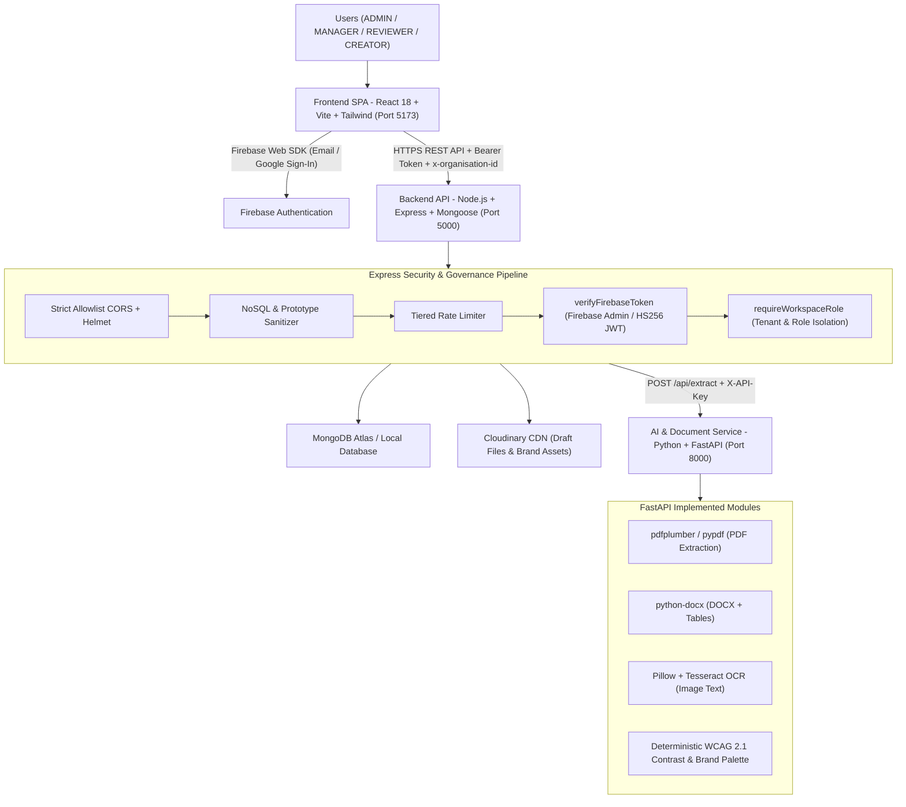
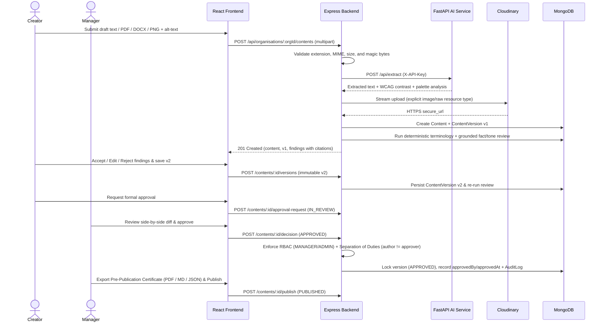
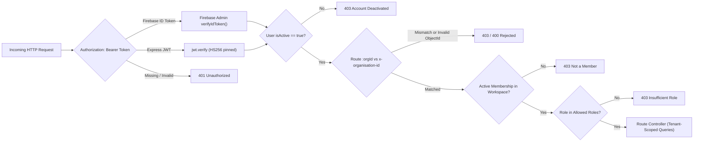
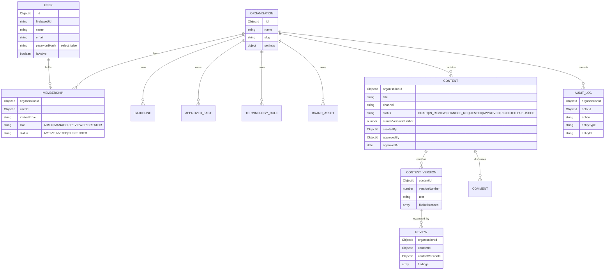

# BrandLens AI — System Architecture

> **Intelligent brand governance, before you publish.**

This document describes the actual implemented architecture of **BrandLens AI**, including service boundaries, request flows, security controls, data modeling, and current implementation status vs. planned extensions.

---

## 1. High-Level System Architecture

BrandLens AI uses a three-service architecture backed by MongoDB (Atlas or local), Firebase Authentication, and Cloudinary object storage.

---

## 2. Service Responsibilities & Boundaries

### 2.1 Frontend (`frontend/`)
- **Stack:** React 18, Vite 6, Tailwind CSS 3, Lucide React, Firebase Web SDK v13.
- **Entry & Routing:** [App.jsx](../frontend/src/App.jsx) gates all workspace tabs behind [AuthPage.jsx](../frontend/src/pages/AuthPage.jsx) when unauthenticated and synchronizes active tab state with `window.location.hash` (`#dashboard`, `#review`, `#knowledge`, `#approvals`, `#insights`, `#audit`, `#settings`) wrapped in [ErrorBoundary.jsx](../frontend/src/components/common/ErrorBoundary.jsx).
- **Auth & API Layer:**
  - [AuthContext.jsx](../frontend/src/features/auth/AuthContext.jsx) manages Firebase Auth sessions, Express JWT sessions, workspace switching, and quick demo role switching (`CREATOR`, `REVIEWER`, `MANAGER`, `ADMIN`).
  - [services/api.js](../frontend/src/services/api.js) handles REST requests, in-flight `GET` deduplication (evicting rejected calls immediately), and explicit `x-organisation-id` headers.
  - [lib/api.js](../frontend/src/lib/api.js) handles workspace & RBAC calls (`/api/workspaces` with `/api/organisations` fallback).
- **Key Views & Utilities:**
  - [DashboardPage.jsx](../frontend/src/pages/DashboardPage.jsx): Live KPI cards, submission feed, error banner with retry.
  - [KnowledgeBasePage.jsx](../frontend/src/pages/KnowledgeBasePage.jsx): Guidelines, Approved Facts, Terminology Rules, Brand Assets, NovaTech demo pack seeder, and interactive [ContrastChecker.jsx](../frontend/src/components/common/ContrastChecker.jsx).
  - [ReviewPage.jsx](../frontend/src/pages/ReviewPage.jsx): Multi-format file upload (`.pdf`, `.docx`, `.jpg`, `.png`, `.txt`) + alt-text inputs, per-finding Accept / Edit / Reject / Override actions, immutable revision creation, and [DiffViewer.jsx](../frontend/src/components/common/DiffViewer.jsx).
  - [ApprovalsPage.jsx](../frontend/src/pages/ApprovalsPage.jsx): Manager approval gate with Separation of Duties enforcement, version comparison, safe publishing modal, and Pre-Publication Compliance Certificate modal.
  - [InsightsPage.jsx](../frontend/src/pages/InsightsPage.jsx) & [AuditPage.jsx](../frontend/src/pages/AuditPage.jsx): Live governance analytics, ambiguous guideline rewrite queue, append-only audit log explorer, and [certificate.js](../frontend/src/utils/certificate.js) exports (Print/Save PDF, Markdown `.md`, JSON `.json`).
  - [SettingsPage.jsx](../frontend/src/pages/SettingsPage.jsx): Workspace rename, member invitations, and role management.

### 2.2 Backend Application API (`backend/`)
- **Stack:** Node.js (ES Modules), Express 4, Mongoose 8, Firebase Admin SDK 14, `jsonwebtoken` (`HS256`), `bcryptjs`, `multer`, `cloudinary`, `helmet`, `cors`, `morgan`.
- **Security Pipeline (in execution order in [app.js](../backend/src/app.js)):**
  1. `trust proxy` + `x-powered-by` disabled.
  2. Strict allowlist CORS (`FRONTEND_ORIGIN` / `ALLOWED_ORIGINS`, never reflecting arbitrary origins with credentials).
  3. `helmet` security headers.
  4. Body parsing (`10mb` limit) + [security.js](../backend/src/middleware/security.js) recursive NoSQL `$`/`.` key & prototype-pollution sanitizer.
  5. Tiered fixed-window rate limiting ([rateLimiter.js](../backend/src/middleware/rateLimiter.js)) on `/api/`, `/api/auth/*`, and upload endpoints.
  6. [verifyFirebaseToken.js](../backend/src/middleware/verifyFirebaseToken.js) authenticating Firebase ID tokens (primary) and `HS256`-pinned Express JWTs (fallback), rejecting deactivated (`isActive: false`) accounts.
  7. [requireWorkspaceRole.js](../backend/src/middleware/requireWorkspaceRole.js) enforcing ObjectId validation, route-vs-header tenant consistency (`403` on mismatch), active membership lookup, and role allowlists.
  8. Centralized [errorHandler.js](../backend/src/middleware/errorHandler.js) sanitizing Mongoose, Multer, JWT, and 5xx errors without exposing stack traces.
- **Compliance & Extraction Orchestration:**
  - [fileValidation.js](../backend/src/utils/fileValidation.js): Enforces extension + MIME type + 10MB cap + binary magic-byte checks (blocking SVG/HTML/spoofed uploads) before uploading to Cloudinary or forwarding to `ai-service`.
  - [extractionService.js](../backend/src/services/extractionService.js): Forwards uploaded files to FastAPI `/api/extract` with `X-API-Key` header and falls back resiliently to local text/WCAG alt-text extraction if `ai-service` is unreachable.
  - [review.service.js](../backend/src/modules/reviews/review.service.js): Executes deterministic terminology regex scans (`checkMethod: "DETERMINISTIC"`, 100% precision) and grounded tone/claim checks against the organisation's `ApprovedFact` and `Guideline` collections (never fabricating citations when no approved fact matches).

### 2.3 AI & Document Extraction Service (`ai-service/`)
- **Stack:** Python 3.10+, FastAPI, Uvicorn, Pydantic v2, Pillow, `pdfplumber`, `pypdf`, `python-docx`, `pytesseract`, `python-multipart`.
- **Implemented Endpoints:**
  - `GET /` — Service metadata.
  - `GET /health` — Health check (`status`, `service`, `version`, `environment`).
  - `GET /api/status` — Configured `AI_PROVIDER`, `AI_MODEL`, `EMBEDDING_MODEL`, supported formats, and active capabilities.
  - `POST /api/extract` — Multi-format document text extraction (`.pdf`, `.docx`, `.doc`, `.txt`, image OCR) + image accessibility/palette analysis (10MB cap, extension validation, constant-time `X-API-Key` check in production).
  - `POST /api/visual-check` — Deterministic Pillow color quantization, WCAG 2.1 AA/AAA luminance & contrast ratios, brand hex palette Euclidean distance matching, and alt-text quality checks.
- **Current AI Scope & Extension Points:** `ai-service/app/providers/` and `ai-service/app/retrieval/` are currently scaffolded for future live Gemini LLM API calls and vector retrieval; they are intentionally kept separate from deterministic checks so deterministic terminology and WCAG checks remain 100% hallucination-free.

---

## 3. End-to-End Content Governance Sequence

---

## 4. Authentication & Multi-Tenant Authorization Flow

---

## 5. Core MongoDB Data Model

All tenant data is scoped by `organisationId`.

---

## 6. Deployment Topology

- **Monorepo Vercel Services ([vercel.json](../vercel.json)):** Declares `frontend` (`vite`), `backend` (`express` with service binding to `AI_SERVICE_URL`), and `ai-service` (`fastapi`), routing `/api/*` to `backend` and `/*` to `frontend`.
- **Render Blueprint ([render.yaml](../render.yaml)):** Configures `brandlens-backend` as a Node web service (`rootDir: backend`, `healthCheckPath: /api/health`) with secrets managed via Render dashboard (`sync: false`).
